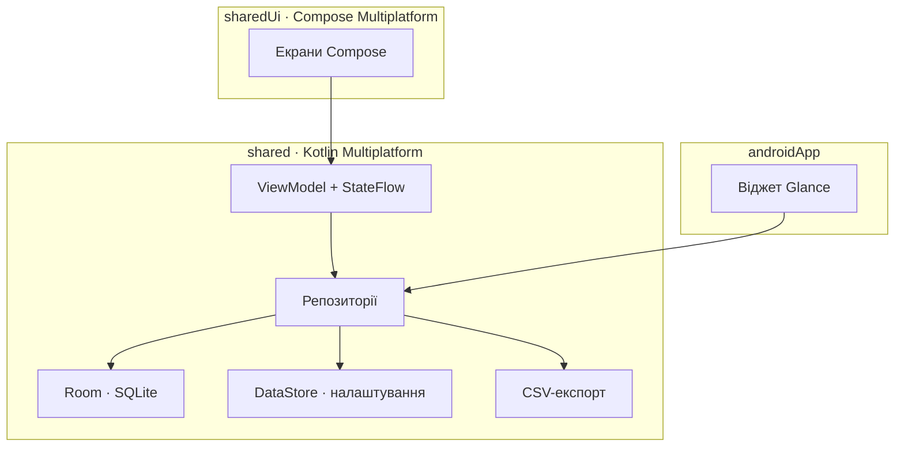

# ТЗ: OwnExpenses, застосунок обліку витрат і надходжень (Android)

Версія від 24.10.2026. Усі відкриті питання закриті, див. розділ «Прийняті рішення».

## Мета та контекст

OwnExpenses: застосунок для Android, який за 2–3 тапи записує витрату й одразу показує поточний баланс. Усі дані зберігаються лише на пристрої, без акаунтів і синхронізації; вивантажити їх можна у CSV.

- **Користувач:** одна людина, особисті фінанси.
- **Платформа:** Android першим, iOS на етапі 5 з тієї ж кодової бази.
- **Ключова цінність:** швидкий запис після кожної витрати й контроль балансу, зокрема на тиждень.

Надходження тут не є фактичними заощадженнями: це сума, яку користувач виділяє на витрати, а баланс показує, скільки з виділеного ще лишилось. Рахунків і карток із окремими залишками немає, баланс один.

## Обсяг

У MVP входить повний цикл «записати → побачити баланс → вивантажити»; усе, що потребує мережі або кількох користувачів, лишається поза ним.

**Входить у MVP**

- Облік витрат і надходжень з категоріями та підкатегоріями, з описом до кожної операції.
- Поточний баланс і підсумки за обраний період.
- Історія з фільтром за періодом, редагуванням і видаленням.
- Експорт у CSV; статистика витрат за днями й категоріями (пріоритет Should).
- Локальна база на пристрої.

**Не входить (поки)**

- Синхронізація, акаунти, хмарні сервіси; майбутній власний сервіс з API для заощаджень.
- Кілька валют і курси; рахунки й картки (баланс один).
- Ліміти бюджету по категоріях.
- Повторювані платежі, імпорт із банків, сканування чеків, захист входу PIN-кодом чи біометрією, поділ запису на кілька категорій.
- iOS-збірка (етап 5).

## Функціональні вимоги

Одинадцять вимог: сім обов'язкових для MVP (Must) і чотири бажані (Should), які можна відкласти без шкоди для основного сценарію.

| ID | Вимога | Пріоритет |
| --- | --- | --- |
| FR-1 | Додати витрату: сума, категорія або підкатегорія, дата (за замовчуванням сьогодні), опис (необов'язково) | Must |
| FR-2 | Додати надходження: сума, категорія надходження (зарплата, подарунок тощо), дата, опис (необов'язково); це виділена на витрати сума, не обов'язково реальні заощадження | Must |
| FR-3 | Категорії й підкатегорії: набір за замовчуванням окремо для витрат і надходжень; додати, перейменувати, змінити колір чи іконку; підкатегорії на один рівень углиб; архівувати замість видалення, якщо є записи | Must |
| FR-4 | Історія операцій з фільтром за періодом (день, тиждень, місяць, рік, увесь час, довільний діапазон); групування за днями з підсумком дня; редагування, видалення зі скасуванням (undo); фільтр за категоріями й підкатегоріями та пошук за описом | Must |
| FR-5 | Поточний загальний баланс завжди видно на головному екрані; від обраного періоду він не залежить | Must |
| FR-6 | Підсумок обраного періоду: надходження, витрати, суми за категоріями; на початку кожного місяця вони починаються з нуля, а баланс не скидається | Must |
| FR-7 | Експорт у CSV за обраний період | Must |
| FR-8 | Резервна копія й відновлення повного набору даних | Should |
| FR-9 | Віджет на домашньому екрані зі швидким вводом | Should |
| FR-10 | Статистика витрат за днями: стовпчикова діаграма за обраний період | Should |
| FR-11 | Статистика витрат за категоріями й підкатегоріями: кільцева діаграма та список із сумами й відсотками | Should |
| FR-12 | Одноразовий імпорт операцій із CSV-експорту Sumlio (попереднього застосунку власника) | Should |

## Розрахунок балансу

Баланс накопичувальний: це сума всіх надходжень мінус сума всіх витрат з датою не пізніше сьогодні, без обнулення на початку місяця.

```latex
\text{Баланс} = \sum \text{надходження} - \sum \text{витрати}
```

Приклад з ТЗ: 1-го числа надходження 1000, далі протягом місяця витрати на 777 у сумі, баланс 223.

| Дата | Операція | Сума | Баланс після |
| --- | --- | --- | --- |
| 1 жовтня | Надходження | +1000 | 1000 |
| 3 жовтня | Витрата, продукти | −300 | 700 |
| 9 жовтня | Витрата, транспорт | −150 | 550 |
| 17 жовтня | Витрата, кафе | −327 | 223 |

Правила:

- Баланс може бути від'ємним; тоді він показується червоним.
- Запис із майбутньою датою не впливає на поточний баланс, доки ця дата не настане.
- Редагування чи видалення запису перераховує баланс одразу.
- Окремо від балансу показуються надходження й витрати обраного періоду. На початку кожного місяця вони починаються з нуля, а баланс не скидається: це лише фільтр, баланс завжди рахується за весь час.
- Баланс рахується запитом до бази, а не зберігається окремим полем, щоб він не розходився з історією.

## UX і екрани

Запис витрати має займати три дії: тап по категорії, цифри суми, тап «Додати». Ніяких підтверджень і обов'язкових полів, окрім суми та категорії.

**Сценарій швидкого вводу**

1. На головному екрані тап по плитці категорії (перемикач «Витрата / Надходження» вгорі).
2. Відкривається нижня панель із цифровою клавіатурою; сума вводиться відразу. Над нею чипи підкатегорій (необов'язково) і згорнуте поле опису.
3. Тап «Додати»: панель закривається, баланс оновлюється, знизу з'являється «Скасувати».

**Правила**

- Дата за замовчуванням сьогодні; змінюється чипом на панелі. Опис згорнутий і необов'язковий.
- Плитки стоять у сталому порядку, який задає користувач на екрані категорій; кількість записів чи суми порядок не змінюють.
- Тап по плитці відкриває панель вводу; утримання (стандартний час довгого натискання, з вібровідгуком) відкриває панель категорії: кількість операцій і сума за період, частка від усіх витрат (надходжень) періоду, суми й частки підкатегорій, кнопки «Редагувати» (редактор категорії) і «Операції» (історія з фільтром лише цієї категорії).
- Видалення й помилкове додавання скасовуються через snackbar, без діалогів підтвердження.
- Клавіатура приймає крапку й кому як десятковий роздільник; максимум два знаки після нього.
- Клавіатура рахує прості вирази з + − × ÷ (зручно при редагуванні: «89 + 35»): × і ÷ виконуються раніше за + і −, кожен крок × і ÷ округлюється до копійки, оператор у кінці ігнорується, новий оператор одразу після іншого замінює його. Під виразом видно результат; зберегти можна лише додатний результат, ділення на нуль не обчислюється.

**Кольори**

Палітра категорій насичена (яскраві відтінки, читабельні на темному тлі); у світлій темі іконки й суми кольором категорії затемнюються для контрасту, заливки лишаються як є. Категорії з першої, тьмяної палітри перефарбовуються міграцією бази 1 → 2 і при відновленні старих резервних копій.

**Фільтр за періодом**

Один вибір періоду діє на головному екрані, в історії та в статистиці: день, тиждень (понеділок–неділя), місяць, рік, увесь час, довільний діапазон. За замовчуванням обрано поточний місяць: з початком нового місяця надходження й витрати періоду починаються з нуля, а загальний баланс не змінюється й від періоду не залежить.

**Екрани**

1. Головний: загальний баланс, вибір періоду, перемикач «Витрати / Надходження» із сумами періоду, сітка категорій із сумами за період. Горизонтальний свайп по екрану гортає період, як стрілки (вправо попередній, вліво наступний).

2. Історія: операції за обраний період за днями (кожен день із підсумком), редагування по тапу, видалення свайпом. Угорі пошук за описом (без урахування регістру) і фільтр за категоріями: категорія вмикається разом з підкатегоріями, підкатегорії й записи без підкатегорії можна вибирати окремо, архівні теж доступні. Вибране показано чипами; підсумки періоду рахуються за відфільтрованими записами. Фільтр спільний з головним екраном (кнопка «Операції») і живе до закриття застосунку.
3. Статистика: витрати за днями (стовпчикова діаграма) і за категоріями (кільцева діаграма та список з підкатегоріями). Тап по сегменту кільця показує в центрі назву категорії, її відсоток і суму; повторний тап чи тап у центр повертає загальну суму.
4. Категорії: список, додавання, редагування (назва, колір, іконка), підкатегорії, архівація, зміна порядку перетягуванням (і пунктами «Вгору» / «Вниз» у меню). Відкривається олівцем і плиткою «Додати» на головному екрані та пунктом у «Більше». Категорію без записів можна видалити разом з підкатегоріями й повернути через snackbar; категорію із записами архівовано.
5. Налаштування: валюта, експорт, резервна копія, тема.

Віджет (FR-9): поточний баланс і перші три категорії витрат у порядку користувача з вводом суми без відкриття застосунку. Тап по категорії відкриває лише компактну панель з клавіатурою поверх домашнього екрана; після «Додати» вона закривається, а віджет оновлює баланс.

Статистика за днями (FR-10): для періодів до 62 днів стовпчик відповідає дню, для довших (рік, увесь час, довгий діапазон) — місяцю.

## Модель даних

Дві таблиці в SQLite (Room) і кілька налаштувань у DataStore. Суми зберігаються цілим числом у мінорних одиницях (копійки), щоб уникнути помилок округлення.

| Сутність | Поля | Примітки |
| --- | --- | --- |
| Category | id, parentId (порожній для категорії верхнього рівня), name, type (expense / income), color, icon, sortOrder, isArchived | Тип категорії фіксований, підкатегорія успадковує тип батьківської, глибина один рівень; архівована не показується на головному, але лишається в історії |
| Transaction | id, type (expense / income), amountMinor (Long), categoryId, date (локальна дата), description, createdAt, updatedAt | amountMinor завжди додатний; знак визначає type; categoryId вказує на категорію або підкатегорію |
| Settings (DataStore) | currencyCode, exportDelimiter, themeMode | Валюта одна, за замовчуванням UAH; роздільник CSV за замовчуванням «;» |

- Індекси: `Transaction.date` і `Transaction.categoryId`.
- Дата запису зберігається як календарна дата без часу, щоб зміна часового поясу не зсувала записи між днями.
- Категорії за замовчуванням створюються при першому запуску з локалізованими назвами (uk / en).
- Міграції схеми Room версіонуються з першого релізу. Сума за категорією включає операції всіх її підкатегорій.

## Експорт і резервна копія

Експорт створює один CSV-файл за обраний період (весь час, місяць або довільні дати), який можна зберегти в будь-яку папку або відправити через системне меню «Поділитися». Окремі дозволи на сховище не потрібні.

```csv
date;type;category;subcategory;amount;currency;description
2026-10-01;income;Надходження;;1000,00;UAH;
2026-10-03;expense;Продукти;На роботі;300,00;UAH;Сосиски
2026-10-09;expense;Транспорт;Таксі;150,00;UAH;
2026-10-17;expense;Кафе;;327,00;UAH;Круасани
```

- Кодування UTF-8 з BOM, щоб Excel коректно читав кирилицю.
- Дата у форматі ISO 8601; десятковий роздільник суми залежить від роздільника полів: кома при «;» (так її читає Excel з українською локаллю), крапка при «,».
- Роздільник за замовчуванням крапка з комою (під Excel), у налаштуваннях його можна змінити на кому.
- Одна категорія й одна підкатегорія на рядок; опис із комами береться в лапки.

**Резервна копія (FR-8)**

Повний набір даних, включно з категоріями, зберігається в один файл і відновлюється з нього.

Уточнено на етапі 4:

- Формат: один JSON-файл із версією формату; містить усі категорії (разом з архівними), усі записи й налаштування.
- Відновлення замінює всі поточні дані одразу, в одній транзакції бази. Перед цим файл повністю перевіряється, а користувач один раз підтверджує заміну (діалог підтвердження, бо її не скасувати).
- Загального імпорту CSV немає; є лише імпорт із Sumlio (FR-12).

**Імпорт із Sumlio (FR-12)**

Окрема дія в «Більше» (розділ «Імпорт»), не пов’язана з резервною копією. Призначена для одноразового переходу з Sumlio; приймає лише його CSV-експорт.

- Формат Sumlio: заголовок `Date (UTC),Type,From account / from category,From subcategory,To account / to category,To subcategory,Amount 1,Currency 1,Amount 2,Currency 2,Commission,…,Comment,Tags`, роздільник кома, лапки за RFC 4180. Після операцій ідуть порожні рядки й таблиця рахунків, яка ігнорується (рахунків у нас немає).
- Витрата (`Expense`) береться з категорії «To», надходження (`Income`) з категорії «From»; рахунок ігнорується. Перекази, інші типи й суми не в UAH пропускаються.
- Дата: час UTC переводиться в часовий пояс пристрою й береться календарна дата; мітка часу Sumlio зберігається як `createdAt`, тож порядок у межах дня зберігається.
- Сума округлюється до копійки. Від’ємна сума обертає тип: від’ємна витрата стає надходженням у категорії «Повернення», від’ємне надходження стає витратою в «Інше»; початкова категорія дописується в опис. Так баланс збігається із залишком у Sumlio.
- Опис: коментар, а теги дописуються через « · ».
- Категорії й підкатегорії зіставляються за назвою без урахування регістру серед неархівованих. Відсутні створюються з назвами з Sumlio після наявних, найуживаніші першими; нові категорії отримують кольори палітри, підкатегорії колір та іконку батьківської.
- Дані додаються до наявних, нічого не видаляється. Перед записом діалог показує кількість записів, період, кількість нових категорій і зміну балансу, а користувач підтверджує. Усе пишеться однією транзакцією.
- Повторний імпорт безпечний: запис із тією самою міткою часу, сумою й типом уже вважається імпортованим і пропускається.
- Помилковий рядок (дата чи сума не читаються) зупиняє імпорт повністю з номером рядка; нічого не записується.

## Нефункціональні вимоги

Застосунок повністю автономний: працює без інтернету й не передає жодних даних назовні.

- **Приватність:** у маніфесті немає дозволу INTERNET; дані лише в локальній базі застосунку. Автоматичне резервування Android у хмару вимкнене за замовчуванням.
- **Швидкодія:** запис з'являється в списку й змінює баланс менш ніж за 100 мс після тапу «Додати»; база до 100 000 записів без помітних затримок.
- **Версії Android:** мінімум Android 8.0 (API 26); targetSdk відповідає вимогам Google Play на момент релізу.
- **Інтерфейс:** світла й темна теми за системою; мови uk і en через ресурси рядків без зовнішніх сервісів локалізації; зона тапу не менше 48 dp.
- **Надійність:** запис додається в одній транзакції бази; закриття застосунку під час вводу не псує дані.
- **Тестування:** модульні тести розрахунку балансу й CSV-експорту; UI-тест сценарію швидкого вводу.

## Стек та архітектура

Kotlin Multiplatform з Jetpack Compose: Android збирається першим, уся логіка й дані лежать у спільному модулі, щоб iOS додався без переписування.

| Шар | Технологія | Навіщо |
| --- | --- | --- |
| Мова | Kotlin | Один код для Android і iOS |
| UI | Jetpack Compose (Android); Compose Multiplatform для iOS на етапі 5 | Декларативний UI, спільні екрани; діаграми статистики (стовпчикова й кільцева) малюються через Compose Canvas або легку бібліотеку графіків |
| Архітектура | MVVM, Kotlin Flow / StateFlow | Баланс оновлюється реактивно після кожного запису |
| База даних | Room на SQLite (KMP) | Локальне сховище й запити для балансу та підсумків |
| Налаштування | DataStore | Валюта, тема, роздільник CSV |
| DI | Koin | Працює в KMP, легший за Hilt |
| Віджет | Jetpack Glance | Швидкий ввід з домашнього екрана (FR-9) |
| Експорт | Власна CSV-серіалізація в shared; системний вибір файлу для збереження | Без дозволів на сховище |
| Збірка | Gradle (Kotlin DSL), version catalog | Єдині версії залежностей |

Назва проєкту й репозиторію: OwnExpenses; назва під іконкою: Expenses. ID пакета Android: `com.nackie.ownexpenses` (після публікації в Google Play його вже не змінити).

Модулі: `androidApp` (оболонка Android, віджет), `sharedUi` (екрани на Compose Multiplatform, спільні з iOS), `shared` (моделі, репозиторії, ViewModel, база, CSV), `iosApp` з'являється на етапі 5.



Екрани й віджет працюють через одні й ті самі репозиторії; база, налаштування та CSV-експорт сховані за ними, тому їх можна повторно використати в iOS.

## Етапи розробки

Перший придатний до щоденного користування реліз це етапи 0–3; статистика, віджет, резервна копія й iOS додаються після.

1. **Етап 0, макети й репозиторій.** Макети п'яти екранів, структура KMP-проєкту, схема БД, CI-збірка.
2. **Етап 1, ядро.** Room-база, категорії й підкатегорії за замовчуванням, додавання витрат і надходжень, розрахунок балансу з модульними тестами.
3. **Етап 2, швидкий ввід.** Головний екран із плитками й цифровою панеллю, підкатегорії та опис, undo.
4. **Етап 3, історія й експорт.** Історія з фільтром за періодом, редагування, підсумки періоду, CSV-експорт, теми, локалізація uk / en.
5. **Етап 4, додатково.** Статистика (витрати за днями й за категоріями), віджет Glance, резервна копія й відновлення.
6. **Етап 5, iOS.** Модуль `iosApp` на Compose Multiplatform, перевірка Room і CSV на iOS.

## Прийняті рішення

Підтверджено: підкатегорії мають один рівень, місяць починається 1-го числа, тиждень з понеділка. Відкритих питань немає, можна переходити до макетів і репозиторію.

- Валюта одна, UAH.
- Один запис належить одній категорії або підкатегорії, поділу чека на кілька категорій немає.
- Роздільник CSV за замовчуванням: крапка з комою.
- Захисту входу (PIN, біометрія) немає.
- Мінімальна версія Android: 8.0 (API 26).
- Мови інтерфейсу: uk та en через ресурси рядків, без зовнішніх інтеграцій локалізації.
